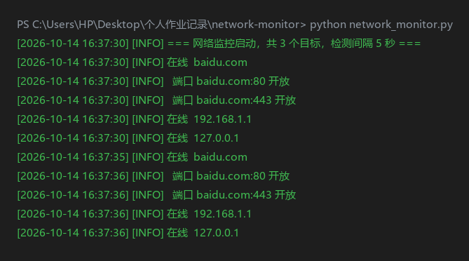

# 网络监控工具 (Network Monitor)

一个使用 Python 标准库编写的轻量级网络监控工具，可定时检测主机在线状态与端口连通性，并将结果记录到日志。零第三方依赖，开箱即用。



## 功能

- **主机在线检测**：通过 ping 判断目标主机是否可达
- **端口连通性检测**：通过 socket 判断指定端口是否开放（如 80/443/53）
- **日志记录**：检测结果带时间戳写入 `monitor.log`
- **误报抑制**：连续多次失败才触发告警，避免网络抖动误报
- **配置化**：监控目标与检测间隔在 `config.json` 中配置，无需改代码

## 技术栈

Python 标准库：`subprocess`、`socket`、`json`、`datetime`、`os`

## 运行方式

```bash
python network_monitor.py
```

按 `Ctrl+C` 停止。

## 配置说明（config.json）

```json
{
  "interval": 5,
  "targets": [
    { "host": "192.168.1.1", "ports": [] },
    { "host": "baidu.com", "ports": [80, 443] },
    { "host": "127.0.0.1", "ports": [] }
  ]
}
```

- `interval`：检测间隔（秒）
- `targets`：监控目标列表，`host` 为主机 IP 或域名，`ports` 为需要检测的端口列表（可为空）

## 运行示例

见上方截图。程序启动后会实时打印检测结果，并同步写入 `monitor.log` 日志文件。
